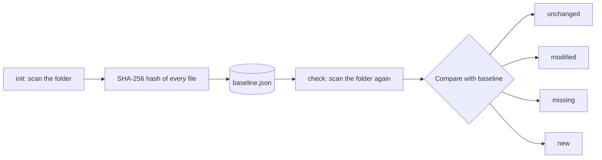

# File Integrity Checker

A small command-line tool, written in Python, that tells you whether the files in a folder have been **modified, deleted or added** since you last looked.

It works by taking a SHA-256 fingerprint (hash) of every file and comparing it with a saved snapshot. The snapshot can also be signed with a secret key, so that tampering with the snapshot itself is detected. It uses only Python's standard library.

## What it does

- Takes a **baseline**: a SHA-256 hash of every file in a folder, including subfolders.
- Re-hashes the folder later and compares it with the baseline.
- Reports every file as **unchanged**, **modified**, **missing** or **new**.
- Exits with a code that scripts can act on (`0` clean, `1` changes, `2` error).
- Optionally signs the baseline with HMAC-SHA256, so editing `baseline.json` by hand is caught.

## How it works

A hash is a fixed-size fingerprint of a file's contents. Change even one byte and the fingerprint becomes completely different, so comparing hashes is a reliable way to spot changes.



1. `init` hashes every file and saves the result as the baseline.
2. `check` hashes the folder again and compares it with the baseline.
3. `update` accepts the folder's current state as the new baseline, after you have reviewed the changes.

## Requirements

Python 3.8 or newer (developed and tested on Python 3.12). No third-party packages.

## Quick start

From the project folder, the commands below take a baseline of the sample folder, tamper with a file, see it get caught, accept the change, and clean up.

```bash quickstart
python3 integrity.py init sample_data
python3 integrity.py check
echo "tampered" >> sample_data/notes.txt
python3 integrity.py check || echo "exit code: $?"
python3 integrity.py update
python3 integrity.py check
echo "Meeting notes: project kickoff." > sample_data/notes.txt
rm baseline.json
```

After the tampering, the second `check` prints a report like this (your folder path and times will differ):

```text
===================================================
FILE INTEGRITY REPORT
=================================================
Folder:        /home/you/file-integrity-checker/sample_data
Baseline from: 2026-10-28T13:24:55
Checked at:    2026-10-28T13:25:10

STATUS: CHANGES DETECTED

Unchanged: 2
Modified:  1
Missing:   0
New:       0

[MODIFIED]
  - notes.txt
```

## Commands

| Command | What it does |
|---|---|
| `init <folder>` | Create a baseline for a folder. Refuses to overwrite an existing baseline unless you add `--force`. |
| `check` | Compare the folder with the baseline and print a report. Add `--report FILE` to also save it. |
| `update` | Accept the folder's current state as the new baseline. |

Every command accepts `--baseline FILE` to use a baseline other than `baseline.json` in the current directory.

```bash
python3 integrity.py init sample_data --baseline my_baseline.json
python3 integrity.py check --baseline my_baseline.json --report report.txt
python3 integrity.py update --baseline my_baseline.json
python3 integrity.py init sample_data --force
```

## Protecting the baseline (signing)

Without a key, anyone who can edit your files can also edit `baseline.json` to hide the change. To stop that, set a secret key in the `INTEGRITY_KEY` environment variable. The baseline is then signed with HMAC-SHA256 and the signature is saved next to it as `baseline.json.sig`.

```bash
export INTEGRITY_KEY="$(python3 -c 'import secrets; print(secrets.token_hex(32))')"
python3 integrity.py init sample_data
python3 integrity.py check
```

With a key set:

- `init` and `update` sign the baseline.
- `check` and `update` verify the signature **before** trusting the baseline. If it does not match, they stop with an error.
- A missing signature is an error, so removing `baseline.json.sig` does not switch the protection off.
- A signed baseline cannot be checked without the key.
- The key is never written to disk by the tool.

Keep the key somewhere safe and separate (for example a password manager), and never commit it. Without the key, the signature cannot be forged.

## Exit codes

| Code | Meaning |
|---|---|
| `0` | No changes detected |
| `1` | Changes detected (modified, missing or new files) |
| `2` | Error (missing or damaged baseline, bad signature, folder not found, bad usage) |

## Project structure

```text
integrity.py        command-line tool: init, check, update
checker.py          SHA-256 hashing and folder scanning
baseline.py         saving and loading the baseline
compare.py          comparing a scan with the baseline
report.py           building and saving the report
signing.py          HMAC signing and verification
test_*.py           unit tests and end-to-end tests
sample_data/        a small folder to practise on
```

## Running the tests

```bash
python3 -m unittest -v
```

The tests cover every module, and the end-to-end tests run the real script the way a user would, both with and without signing. One test is marked as an expected failure on purpose: it shows that an unsigned baseline cannot resist someone who edits both a file and the baseline, which is exactly why signing exists.

## Security notes and limitations

- **The key is what protects the baseline.** Anyone who has the key can re-sign a forged baseline. Keep it off the monitored machine where possible.
- **Unsigned mode is weaker.** Without a key, a person who can change your files and `baseline.json` can hide the change.
- **It only looks when you ask.** Changes are found when `check` runs. Nothing is monitored in real time, and nothing stops a change from happening.
- **Only file contents are compared.** Timestamps, permissions and ownership are ignored, so touching a file is not a change.
- **A rename shows up as one missing file plus one new file.**
- **A few folders are always skipped:** `.git`, `__pycache__`, `node_modules` and `.venv`.
- It is a learning project. For production systems, look at established tools such as AIDE or Tripwire.

## Ideas for the future

- A configurable ignore list, stored in the baseline.
- Real-time monitoring of the folder.
- Scheduled checks with an alert by email or message.
- Storing the baseline and signature off the machine, or on read-only media.
- A JSON report format for other tools to read.
- Detecting renames by matching hashes.
- Tracking permissions and ownership.
